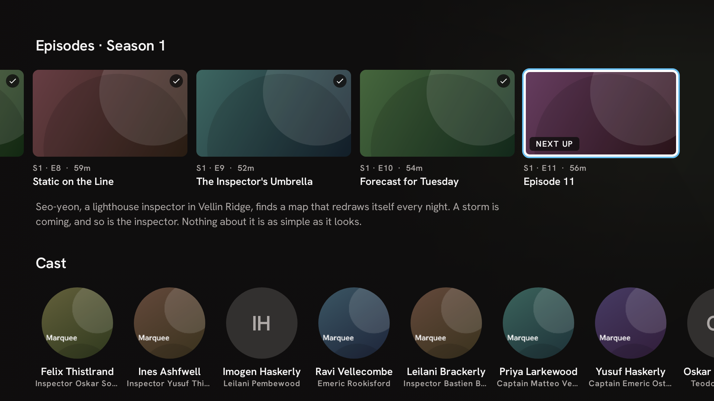
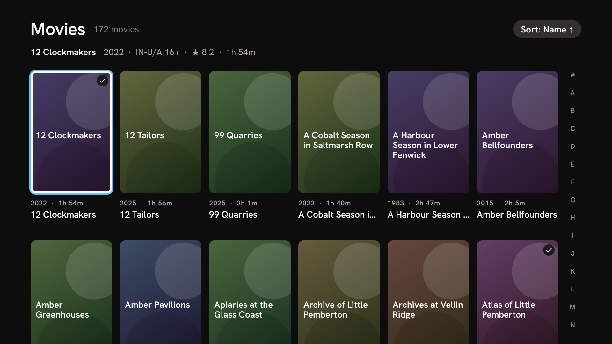
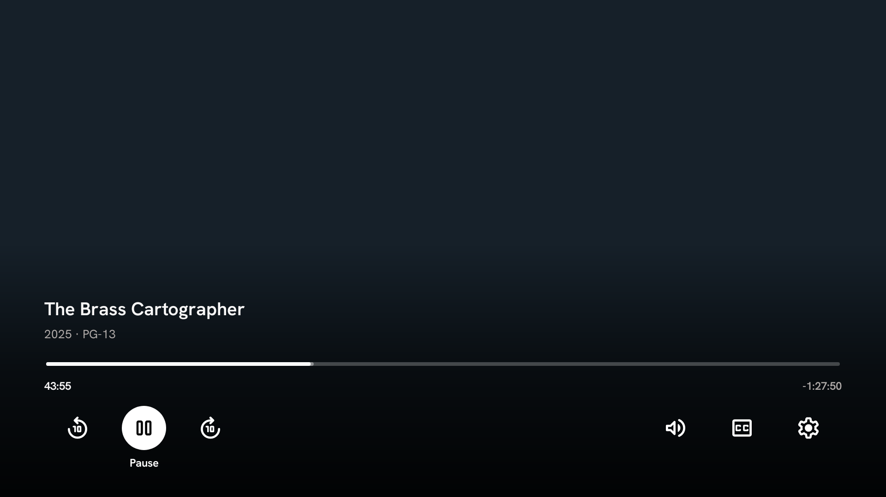
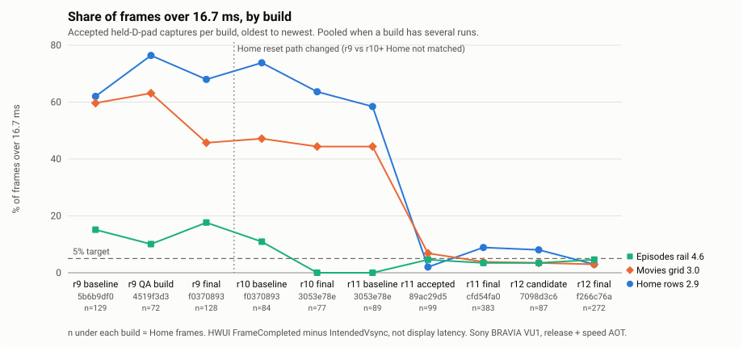
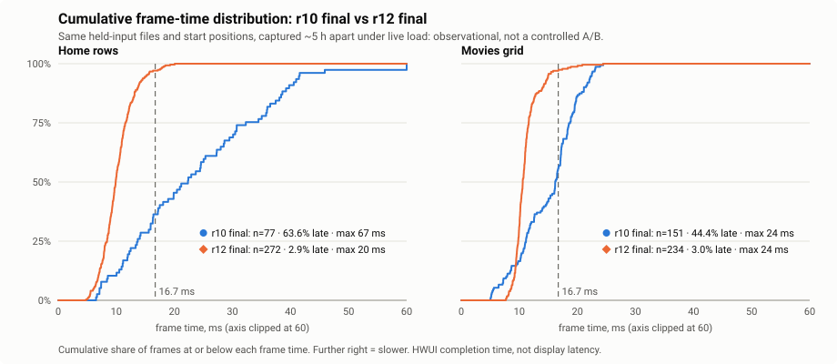

# Marquee

<p align="center">
  <picture>
    <source media="(prefers-color-scheme: dark)" srcset="design/brand/logo/lockup-on-dark.svg">
    
  </picture>
</p>

**An unofficial native Android TV client for [Jellyfin](https://jellyfin.org/),
built for remote-control navigation and low-end TV hardware.**

Marquee is a single-purpose Android TV app for browsing and playing your
Jellyfin library. It uses Jetpack Compose for browsing and AndroidX Media3 for
playback, and was tuned on a modest TV: four Cortex-A55 cores, a Mali-G31 GPU and
2 GB of RAM. Focus moves, scrolling and screen changes happen on the next frame,
with no decorative animation.

> **Status: early, pre-1.0.** Marquee has been used on **one** device: a Sony
> BRAVIA VU1 (Android 11) with Jellyfin server 10.11.x. Everything else is
> untested, including other TVs, arm64 devices, and the generic device-capability
> detection added for this public release. Reports from other hardware are very
> welcome.
>
> Marquee is not affiliated with, sponsored by or endorsed by the Jellyfin
> project.

<p align="center">
  
  
  
  
</p>

<sub>Screenshots are **offline renders of synthetic data**. They are produced by
the Robolectric/Roborazzi screenshot tests from an invented library with
placeholder artwork, not captured from a TV. See
[docs/media/screens/MANIFEST.md](docs/media/screens/MANIFEST.md).</sub>

## Features

Everything below exists in the code today.

**Signing in**
- Enter your server address (`http://` or `https://`). Marquee checks it and
  shows the server's name.
- **Quick Connect**: approve a code from another device that is already signed
  in.
- Username and password, with a profile picker when the server lists its users.
  The password is never stored.
- Switch user or sign out from Settings. Settings also lists the open-source
  licences and third-party notices bundled in the app.

**Browsing**
- **Home**: a full-bleed billboard for the focused item, then Continue
  Watching, Next Up, Recently Added, and shelves for origin/language (for
  example Korean, Hindi & Indian, British, Japanese & Anime) and genre. These
  shelves are built on the device from your library. Home draws from a disk
  snapshot at startup, then refreshes.
- **Libraries** (movies, shows, collections, music albums, playlists): a grid
  with sort (name, date added, release date, rating, runtime, random), filters
  (unwatched, favourites, genre, decade) and A–Z jump.
- **Detail pages** for movies, series and episodes: synopsis sheet, season
  selector and episode row, cast, *More like this*, extras and trailers.
  Choose the version, audio track and subtitles before playing. Mark as watched
  or favourite.
- **Person pages** and **search** (titles and people, with recent searches).

**Playback** (AndroidX Media3 ExoPlayer, `SurfaceView`)
- Direct play first. If that is not possible, Marquee falls back in order to a
  remux that copies the video and converts only the audio, then an HEVC
  encode, then an H.264 1080p encode. It moves down automatically when a step
  fails.
- Device-aware profile: built from the decoders and HDR modes the device
  reports, with a measured profile for the reference TV.
- **HDR10 / HLG** on HDR displays. Dolby Vision profile 8.x and profile 7
  (HDR10-compatible) play through their base layer. Profile 5 is tone-mapped by
  the server.
- Audio and subtitle track selection, preferred languages, Jellyfin subtitle
  modes, text and bitmap (PGS/VobSub/DVB) subtitles.
- **Skip Intro / Skip Credits** from Jellyfin media segments: a button, automatic,
  or off.
- Autoplay of the next episode with a countdown, an episodes panel, and
  playback speed.
- **Trickplay** thumbnails while seeking. Held D-pad seeking accelerates.
- Reports start, progress and stop to the server, so Continue Watching and Next
  Up stay correct.
- Optional diagnostics overlay showing play method, codecs, bitrate, buffer,
  dropped frames and audio path.
- Software audio decoders (FFmpeg) as a last resort for formats the device
  cannot decode.

**Not included:** Live TV and DVR, a dedicated music player (albums can be browsed,
but there is no queue or audio-player UI), downloads and offline
playback, casting, `MediaSession` / voice control, multi-server profiles, and
Google Play distribution.

## Supported devices

| | |
|---|---|
| Platform | Android TV / Google TV, landscape, D-pad remote |
| Minimum Android | 8.0 (API 26) |
| Target API | 36 |
| ABIs (release) | `armeabi-v7a`, `arm64-v8a` (arm64 untested on device) |
| Server | **Tested only with Jellyfin 10.11.11.** Other versions are untested. Skip Intro/Credits needs the media-segments API (Jellyfin 10.10+). |
| **Tested hardware** | **Exactly one device:** Sony BRAVIA VU1, Android 11, armeabi-v7a (Realtek RTD287O, Mali-G31, 2 GB RAM, 1080p60 panel) |

Every other device, Android version and server version is **untested**. The
measured capabilities of the reference TV, and how other devices are detected,
are described in [docs/architecture/TV_CAPABILITIES.md](docs/architecture/TV_CAPABILITIES.md).
Google's current TV distribution requirements, and how Marquee maps to them, are
in [docs/RELEASE_REQUIREMENTS.md](docs/RELEASE_REQUIREMENTS.md).

## Install

There are no published releases yet. When there are, signed APKs will be
attached to [GitHub Releases](https://github.com/aaditagrawal/marquee/releases). Each
will come with a SHA-256 checksum and a build-provenance attestation, which also
suits tools like Obtainium.

To sideload an APK with ADB:

```sh
adb connect <tv-address>:5555                 # if the TV uses network debugging
adb -s <device> install -r marquee-X.Y.Z.apk
# or, with checks for ABI and installed bytes:
tools/install-apk.sh --serial <device> --apk marquee-X.Y.Z.apk
```

Enable developer options and USB/network debugging on the TV first, and accept
the authorisation prompt. An APK signed with a different key cannot update an
existing install. Uninstall the old one first; this removes its sign-in and
settings.

## First run

1. Open **Marquee** from the TV launcher.
2. Enter your Jellyfin server address, for example
   `http://jellyfin.local:8096` or `https://media.example.org`. If you leave out
   the scheme, Marquee tries `https://` first and falls back to `http://` only if
   HTTPS cannot be reached there (for `http://` without a port it tries `:8096`
   and then `:80`). If the server answers HTTPS with a certificate that is not
   trusted, Marquee stops and asks you to fix the certificate or type `http://`
   yourself. The first address that answers as a Jellyfin server is saved.
3. Choose **Quick Connect** and approve the code shown, from the Jellyfin web
   app or another client (*Settings → Quick Connect*). Or choose your profile,
   or type a username, and enter your password.
4. Optional: in **Settings**, set the maximum bitrate, preferred audio and
   subtitle languages, subtitle mode, skip intro/credits behaviour, autoplay,
   image quality and the diagnostics overlay.

Prefer `https://` whenever your server supports it. With `http://`, your
password, access token and media cross the network unencrypted, and the sign-in
screen shows "Unencrypted connection (http)" under the server address (see
[PRIVACY.md](PRIVACY.md#cleartext-http)).

## Build from source

Requirements:

- JDK 21 (`JAVA_HOME`), for example Temurin 21.
- Android SDK with platform 36 (`ANDROID_HOME`, or `sdk.dir` in an untracked
  `local.properties`).
- About 2 GB of free memory. The Gradle wrapper (Gradle 9.5.1) downloads
  everything else.

```sh
./gradlew :app:assembleDebug      # app/build/outputs/apk/debug/   → com.mav.marquee.debug ("Marquee DEV")
./gradlew :app:assembleRelease    # app/build/outputs/apk/release/ → com.mav.marquee, R8-minified
```

**Release signing is opt-in.** Without signing configuration, `assembleRelease`
produces `app-release-unsigned.apk`. Android will not install it until it is
signed, and the debug key is never used for release builds. To sign during the
build, provide **all four** values: as environment variables, as Gradle
properties, or in a gitignored `keystore.properties` (copy
[keystore.properties.example](keystore.properties.example)). A partial set fails
the build.

```sh
export MARQUEE_KEYSTORE_FILE=/secure/path/release.jks   # or -Pmarquee.keystore.file=…
export MARQUEE_KEYSTORE_PASSWORD=…                      # or -Pmarquee.keystore.password=…
export MARQUEE_KEY_ALIAS=…                              # or -Pmarquee.key.alias=…
export MARQUEE_KEY_PASSWORD=…                           # or -Pmarquee.key.password=…
./gradlew :app:assembleRelease
```

Release APKs contain `armeabi-v7a` and `arm64-v8a` native libraries. Add
`-Pmarquee.abiSplits=true` to also get per-ABI APKs. Debug APKs keep every ABI
the FFmpeg decoder ships, including x86 and x86_64 for emulators. Set the version
with `-Pmarquee.versionCode=N -Pmarquee.versionName=x.y.z`. Release builds strip
info and debug logging. Everything else is documented in
[docs/dev/BUILD_NOTES.md](docs/dev/BUILD_NOTES.md). Never commit keystores or
passwords; `.gitignore` excludes the common file names.

Tests and checks (all offline; no TV, emulator or server needed):

```sh
./gradlew :app:lintDebug
./gradlew :app:verifyRoborazziDebug   # unit tests + screenshot goldens
tools/check-motion.sh
```

See [docs/dev/TESTING.md](docs/dev/TESTING.md) and
[CONTRIBUTING.md](CONTRIBUTING.md).

## Architecture

- **Two activities:** `MainActivity` is a single-activity Compose browse UI
  with a small custom navigator. `PlayerActivity` is View-based, with Media3
  ExoPlayer rendering to a `SurfaceView` so HDR reaches the display's video
  plane.
- **Data layer:** a shared OkHttp client adds Jellyfin's `Authorization` header
  only for the configured server. Repositories use `kotlinx.serialization`;
  Home and the library catalogue are cached on disk (stale-while-revalidate).
- **Image pipeline:** Coil 3 on the same OkHttp client. Images are decoded as
  RGB_565 at exact display sizes into bounded caches. BlurHash placeholders,
  Home backdrops with pre-baked scrims, and no fades.
- **Playback:** device capabilities lead to a Jellyfin DeviceProfile, then
  PlaybackInfo, then `StreamResolver` picks direct play, remux or an encode,
  with automatic step-down recovery. Detail pages pre-warm playback.

More detail: [docs/architecture/](docs/architecture/README.md) (overview,
playback decisions, player contract, data API, image sizes, preferences,
diagnostics), and the design system in [design/DESIGN.md](design/DESIGN.md).

## Benchmarks

Marquee opens Home from a saved library snapshot while fresh data loads.
Native rows reuse views as you scroll with the remote.

### Compared with Jellyfin for Android TV

On a Sony BRAVIA VU1 running Android 11, the installed Marquee build reached
its first Home frame in about half the time of the official Jellyfin app.

| Metric | Jellyfin 0.19.10 | Marquee 0.1.0 |
|---|---:|---:|
| Cold launch to first Home frame, median | 1.34 s | 0.66 s |
| Continue Watching frame time, median | 55.8 ms | 9.4 ms |
| Continue Watching frame time, 95th percentile | 141.1 ms | 13.9 ms |
| Frames taking more than 16.7 ms | 714/718 (99.4%) | 10/522 (1.9%) |
| Median app memory on Home (PSS) | 127 MiB | 92 MiB |

Measured on 2026-11-18. Seven cold launches per app kept saved logins and disk
caches. Launch timing ends at the first Home or browse activity frame. Memory
was sampled about five seconds later. Both apps ran the same held-D-pad
sequence on Continue Watching three times. Frame times measure Android's
rendering work before display presentation. Jellyfin used its existing
`speed-profile` ART compilation and Marquee used `speed`. These results
describe the installed builds on this TV. The current source tree still
awaits an on-device benchmark.

[Earlier development measurements, raw data and methods](docs/benchmarks/README.md)

<!-- BENCH-SUMMARY:START -->
### Reference-device measurements (private development builds)

All numbers below are from private development builds on **one Sony BRAVIA VU1**
(Android 11, Realtek RTD287O / 4× Cortex-A55, Mali-G31, 2 GiB, 1080p60), on
2026-10-12 and 10-13, talking to Jellyfin 10.11.11 over household Wi-Fi. All
headline figures are from release (R8) builds compiled with full `speed` AOT,
except the "Full AOT vs no AOT" row, which compares full AOT against launches
without it (`verify` and `speed-profile`). **The code in this
repository has not been benchmarked yet.** Most figures are single short runs.
Details, raw data and caveats: [docs/benchmarks](docs/benchmarks/README.md).

| What | Result | n, build |
|---|---|---|
| Held-D-pad navigation, final accepted UI build: share of frames over 16.7 ms | Home 2.9%, Movies 3.0%, Episodes 4.6%, Search 3.1% | 272 / 234 / 87 / 318 frames, `f266c76a` |
| Same, p50 / p99 frame time | Home 9.9 / 18.4 ms, Movies 10.6 / 20.0 ms, Episodes 11.2 / 22.6 ms | as above |
| Home before the r11 native-rail work (same protocol, earlier APK; not a controlled A/B) | 58–64% of frames over 16.7 ms, p99 67–90 ms | 77–89 frames, `3053e78e` |
| Movies grid, same-APK control: legacy lazy grid → retained native rows | 64.7% → 46.2% of frames late, p99 52 → 30 ms | 235 / 210 frames, `eec21927` |
| Cold start to a drawn Home (warm disk cache, saved login) | median 752 ms (691–816) | 3 launches, `4519f3d3` |
| Warm return to Home (excludes bring-to-front) | median 22 ms (17–48) | 3 launches, `4519f3d3` |
| Full AOT vs no AOT, entry build: cold start to Home | 1015 ms vs 1782 ms median | 4 + 4 launches, `67142546` |
| Playback start, direct play (1080p-class SDR to 3164×2152 HDR) | 0.6–1.8 s to first frame (601–1844 ms) | 7 starts, 5 titles (1–2 each), `4519f3d3` |
| Resume / seek, final player build | 0.8–1.0 s resume, 0.5–1.9 s seek; resumes land 2.5–3.7 s before the saved position (keyframe-snapped) | 1 each, `d2d2e752` |
| Release APK size | 3.80 MB (`armeabi-v7a` only) | `f266c76a` |

Frame time here is HWUI's `FrameCompleted − IntendedVsync` under synthetic USB
key-repeat input. It is not display latency or input latency, so this record
makes no claim of a sustained 60 fps. The player controls overlay could not be
measured on the final UI build because playback failed to start (the TV's
hardware decoder could not acquire resources; playback worked again after a
TV reboot). Server video transcodes never
reached a first frame on the TV. No other hardware was tested.





For comparison, the unsigned release APK built from this repository is 5.36 MB
(universal, `armeabi-v7a` + `arm64-v8a`); per-ABI splits are 3.84 MB and 3.94 MB.
That is a host build fact, not a device measurement: this code has not been run
on a TV. See [docs/dev/BUILD_NOTES.md](docs/dev/BUILD_NOTES.md).
<!-- BENCH-SUMMARY:END -->

## Known limitations

- Tested on one device only (see above). arm64, 16 KB page-size devices and
  non-Sony hardware have never run this code.
- Jellyfin 10.11's encoder does not preserve HDR in full video transcodes, so
  those play as SDR. Direct play and video-copy remux keep HDR.
- There is no `MediaSession`, so system and voice media controls do not work.
- Compressed audio passthrough is off by default. It is only used on a verified
  HDMI ARC/eARC route.
- The UI is English only, and the layout was only checked at 1920x1080
  (960x540 dp).
- Distribution is by sideloading. No App Bundle or Google Play listing exists.

## Privacy

Marquee talks only to the Jellyfin server you enter. It has no analytics,
advertising, crash reporting or telemetry. It stores the server URL, an access
token (in app-private storage, not Keystore-encrypted), your user ID and name, a
random per-install device ID, preferences, recent searches and cached artwork
and library snapshots. It asks only for the `INTERNET`, `ACCESS_NETWORK_STATE`
and `WAKE_LOCK` permissions. Details, including cleartext-HTTP risks and how to
remove data: [PRIVACY.md](PRIVACY.md). Security reports: [SECURITY.md](SECURITY.md).

## License

Marquee is free software, licensed under the **GNU General Public License
v3.0 or later** ([LICENSE](LICENSE), [NOTICE](NOTICE)). Release builds include
the Jellyfin project's GPL-3.0 Media3 FFmpeg decoder, so the combined APK is
distributed under GPLv3. The other dependencies are Apache-2.0, and the bundled
Hanken Grotesk font is SIL OFL 1.1.

[THIRD_PARTY_NOTICES.md](THIRD_PARTY_NOTICES.md) covers every bundled component,
the evidence for each licence, and how to obtain the complete corresponding
source for any APK. The same notices and every licence text ship in the APK
(`assets/licenses/`) and can be read on the TV under **Settings → Open-source
licences**.

## Trademarks

Marquee is an independent, unofficial client. **It is not affiliated with,
sponsored by or endorsed by the Jellyfin project**; "Jellyfin" is used only to
describe compatibility. Android, Android TV and Google TV are trademarks of
Google LLC. Sony and BRAVIA are trademarks of Sony Group Corporation or its
affiliates. Dolby, Dolby Vision, Dolby Atmos and TrueHD are trademarks of Dolby
Laboratories. DTS is a trademark of DTS, Inc. FFmpeg is a trademark of Fabrice
Bellard. All other names belong to their respective owners.
