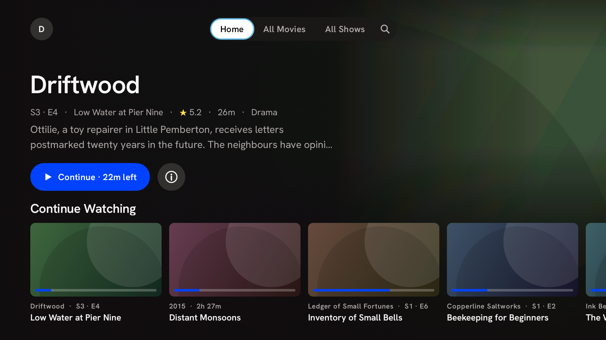
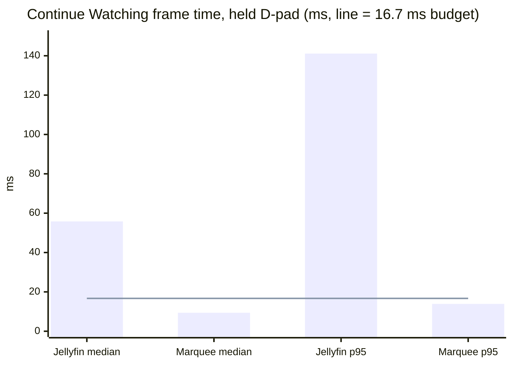

# Marquee

<p align="center">
  <picture>
    <source media="(prefers-color-scheme: dark)" srcset="design/brand/logo/lockup-on-dark.svg">
    
  </picture>
</p>

**An unofficial Android TV client for [Jellyfin](https://jellyfin.org/), built
for the remote control and for low-end TV hardware.**

Marquee browses and plays your Jellyfin library. Browsing is Jetpack Compose,
playback is AndroidX Media3. It was tuned on a modest TV with four Cortex-A55
cores, a Mali-G31 GPU and 2 GB of RAM. Nothing in the interface animates for
decoration. Focus moves and screen changes are drawn directly, and a CI check
([`tools/check-motion.sh`](tools/check-motion.sh)) keeps it that way.

> **Status: early, pre-1.0.** Marquee has run on exactly one device, a Sony
> BRAVIA VU1 (Android 11) with Jellyfin 10.11.11. Other TVs, arm64 devices and
> the device-capability detection added for the public release are untested.
> Reports from other hardware are welcome.
>
> Marquee is not affiliated with, sponsored by or endorsed by the Jellyfin
> project.

<p align="center">
  
  
  
  
</p>

<sub>These are offline renders of an invented library with placeholder artwork,
produced by the screenshot tests. They are not TV captures. See
[docs/media/screens/MANIFEST.md](docs/media/screens/MANIFEST.md).</sub>

## Get Marquee

**There is no published APK yet.** The
[Releases page](https://github.com/aaditagrawal/marquee/releases) is empty, and
Marquee is not on Google Play. For now, [build it from source](#build-from-source)
and sideload it.

The release workflow can sign APKs and attach a SHA-256 checksum and build
attestation on GitHub Releases.

To try the debug build, enable USB or network debugging on the TV and accept
its authorization prompt. Find the device serial with `adb devices`, then install:

```sh
adb connect <tv-address>:5555                 # only for network debugging
adb -s <device> install -r app/build/outputs/apk/debug/app-debug.apk
# or, with ABI and installed-bytes checks:
tools/install-apk.sh --serial <device> --apk app/build/outputs/apk/debug/app-debug.apk
```

An APK signed with a different key cannot update an existing install. Uninstall
the old one first, which also removes its sign-in and settings.

## Requirements

| | |
|---|---|
| Device | Android TV or Google TV with a D-pad remote, landscape |
| Android | 8.0 (API 26) or newer. Target API 36 |
| ABIs | `armeabi-v7a`, `arm64-v8a` (arm64 never run on a device) |
| Server | Jellyfin. Only 10.11.11 has been tested. Skip Intro/Credits needs the media-segments API from 10.10 |
| Tested hardware | One Sony BRAVIA VU1: Android 11, 32-bit userspace, Realtek RTD287O, Mali-G31, 2 GB RAM, 1080p60 panel |

How Marquee detects what other devices can decode is in
[docs/architecture/TV_CAPABILITIES.md](docs/architecture/TV_CAPABILITIES.md).
Google's TV distribution requirements and how Marquee maps to them are in
[docs/RELEASE_REQUIREMENTS.md](docs/RELEASE_REQUIREMENTS.md).

## First run

1. Open **Marquee** from the TV launcher.
2. Enter your server address, for example `https://media.example.org` or
   `http://jellyfin.local:8096`. Without a scheme, Marquee tries `https://`
   first and falls back to `http://` only if HTTPS is unreachable. A plain
   `http://` address without a port tries `:8096`, then `:80`. If the server
   presents an untrusted certificate, Marquee stops rather than silently
   downgrading. Fix the certificate or type `http://` yourself.
3. Sign in with **Quick Connect** (approve the code from the Jellyfin web app or
   another signed-in client, under *Settings → Quick Connect*), or pick your
   profile and enter your password. The password is never stored.
4. Optional: in **Settings**, set maximum bitrate, preferred audio and subtitle
   languages, subtitle mode, Skip Intro/Credits behaviour, autoplay, image
   quality and the diagnostics overlay.

Use `https://` if your server supports it. Over `http://` your password, access
token and media cross the network unencrypted, and the sign-in screen says so
([PRIVACY.md](PRIVACY.md#cleartext-http)).

## Features

**Browsing**
- Home opens with a full-bleed billboard for the focused item, then Continue
  Watching, Next Up, Recently Added, and genre and origin/language shelves (for
  example Korean, Hindi & Indian, Japanese & Anime). The device builds these
  shelves from your library. Home draws from a saved snapshot at startup, then
  refreshes.
- Libraries for movies, shows, collections, music albums and playlists, with
  sorting, filters (unwatched, favourites, genre, decade) and A–Z jump.
- Detail pages for movies, series and episodes: synopsis, seasons and episodes,
  cast, *More like this*, extras and trailers. Pick the version, audio track and
  subtitles before playing. Mark as watched or favourite.
- Person pages, and search across titles and people with recent searches.
- Switch user or sign out from Settings, which also lists the bundled
  open-source licences.

**Playback** (Media3 ExoPlayer on a `SurfaceView`)
- Direct play first. When that fails, Marquee steps down automatically: remux
  with only the audio converted, then an HEVC encode, then H.264 1080p.
- The Jellyfin device profile is built from the decoders and HDR modes the TV
  reports.
- HDR10 and HLG on HDR displays. Dolby Vision profiles 8.x and 7 play their
  HDR10-compatible base layer. Profile 5 is tone-mapped by the server.
- Audio and subtitle track selection with preferred languages. Text and bitmap
  subtitles (PGS, VobSub, DVB).
- Skip Intro and Skip Credits from Jellyfin media segments, as a button,
  automatic, or off.
- Next-episode autoplay with a countdown, an episodes panel and playback speed.
- Trickplay thumbnails while seeking. Holding the D-pad accelerates the seek.
- Start, progress and stop are reported to the server, so Continue Watching and
  Next Up stay correct.
- An optional diagnostics overlay with play method, codecs, bitrate, buffer,
  dropped frames and audio path.
- FFmpeg software audio decoders as a last resort.

**Not included:** Live TV and DVR, a music player (albums browse but there is no
queue or audio UI), downloads, casting, `MediaSession` and voice control, and
multiple server profiles.

## Performance

On the reference TV, Marquee reached its first Home frame in about half the time
of the official Jellyfin app, and stayed close to the 60 Hz frame budget while
scrolling Continue Watching.

| Sony BRAVIA VU1, Android 11, 2026-11-18 | Jellyfin for Android TV 0.19.10 | Marquee 0.1.0 |
|---|---:|---:|
| Cold launch to first Home frame, median of 7 | 1.34 s | 0.66 s |
| Continue Watching frame time, median | 55.8 ms | 9.4 ms |
| Continue Watching frame time, 95th percentile | 141.1 ms | 13.9 ms |
| Frames over 16.7 ms | 714 of 718 (99.4%) | 10 of 522 (1.9%) |
| App memory (PSS) 5 s after Home, median | 127 MiB | 92 MiB |



### Test conditions

- Both apps were installed release builds on the same TV. The test used a
  private Marquee 0.1.0 build. The 0.2.0 source in this repository still
  awaits device benchmarks.
- Each app had seven cold launches in alternating order, with saved logins and
  disk caches kept. Timing ends at the first frame of the Home or browse
  activity.
- Navigation was the same held-D-pad Right/Left sequence on Continue Watching,
  three runs per app. Frame time is Android's `FrameCompleted − IntendedVsync`,
  the time from intended vsync to render completion.
- Jellyfin kept its existing `speed-profile` ART compilation. Marquee was
  compiled with full `speed` AOT. Compilation differences can affect launch
  times.
- One TV, one session, under normal household Wi-Fi traffic. Expect different
  numbers on other hardware.

The raw samples for this comparison are not published yet. The development
measurement record, with methods, raw data and charts, is in
[docs/benchmarks](docs/benchmarks/README.md).

## Build from source

You need JDK 17 or later (CI uses JDK 21), the Android SDK with platform 36 (`ANDROID_HOME`
or `sdk.dir` in an untracked `local.properties`), and about 2 GB of free memory.
The Gradle wrapper fetches the rest.

```sh
./gradlew :app:assembleDebug      # → com.mav.marquee.debug ("Marquee DEV")
./gradlew :app:assembleRelease    # → com.mav.marquee, R8-minified
```

APKs land in `app/build/outputs/apk/`. Without signing configuration,
`assembleRelease` produces `app-release-unsigned.apk`, which Android will not
install. The debug key is never used for release builds. To sign, set all four
values as environment variables, Gradle properties or a gitignored
`keystore.properties` (see [keystore.properties.example](keystore.properties.example)).
A partial set fails the build.

```sh
export MARQUEE_KEYSTORE_FILE=/secure/path/release.jks   # or -Pmarquee.keystore.file=…
export MARQUEE_KEYSTORE_PASSWORD=…                      # or -Pmarquee.keystore.password=…
export MARQUEE_KEY_ALIAS=…                              # or -Pmarquee.key.alias=…
export MARQUEE_KEY_PASSWORD=…                           # or -Pmarquee.key.password=…
./gradlew :app:assembleRelease
```

Release APKs include `armeabi-v7a` and `arm64-v8a`. Add
`-Pmarquee.abiSplits=true` for per-ABI APKs, and
`-Pmarquee.versionCode=N -Pmarquee.versionName=x.y.z` to set the version. More
options are in [docs/dev/BUILD_NOTES.md](docs/dev/BUILD_NOTES.md).

Tests run offline, with no TV, emulator or server:

```sh
./gradlew :app:lintDebug
./gradlew :app:verifyRoborazziDebug   # unit tests + screenshot goldens
tools/check-motion.sh
```

See [docs/dev/TESTING.md](docs/dev/TESTING.md) and
[CONTRIBUTING.md](CONTRIBUTING.md).

## How it works

- `MainActivity` hosts the Compose browse UI with a small custom navigator.
  `PlayerActivity` is View-based, so Media3 can render to a `SurfaceView` and
  HDR reaches the display's video plane.
- One OkHttp client adds Jellyfin's `Authorization` header only for the
  configured server. Home and the library catalogue are cached on disk and
  revalidated in the background.
- Coil 3 decodes images as RGB_565 at exact display sizes into bounded caches,
  with BlurHash placeholders and no fades.
- `StreamResolver` turns device capabilities and Jellyfin's PlaybackInfo into
  direct play, remux or an encode, and steps down on failure. Detail pages
  pre-warm playback.

More in [docs/architecture/](docs/architecture/README.md) and the design system
in [design/DESIGN.md](design/DESIGN.md).

## Known limitations

- One tested device. arm64, 16 KB page-size devices and non-Sony hardware have
  never run this code.
- Jellyfin 10.11's encoder drops HDR in full video transcodes, so those play as
  SDR. Direct play and video-copy remux keep HDR.
- No `MediaSession`, so system and voice media controls do nothing.
- Compressed audio passthrough is off by default and only used on a verified
  HDMI ARC/eARC route.
- English only. Layout was checked only at 1920×1080.

## Privacy

Marquee talks only to the Jellyfin server you enter. It has no analytics, ads,
crash reporting or telemetry, and requests only `INTERNET`,
`ACCESS_NETWORK_STATE` and `WAKE_LOCK`. It stores the server URL, an access token
(app-private storage, not Keystore-encrypted), your user ID and name, a random
device ID, preferences, recent searches and cached artwork and library
snapshots. Details and data removal: [PRIVACY.md](PRIVACY.md). Security reports:
[SECURITY.md](SECURITY.md).

## License

GNU General Public License v3.0 or later ([LICENSE](LICENSE), [NOTICE](NOTICE)).
Release builds include the Jellyfin project's GPL-3.0 Media3 FFmpeg decoder, so
the APK as a whole is GPLv3. Other dependencies are Apache-2.0, and the bundled
Hanken Grotesk font is SIL OFL 1.1.

[THIRD_PARTY_NOTICES.md](THIRD_PARTY_NOTICES.md) lists every bundled component,
the evidence for each licence, and how to get the complete corresponding source
for any APK. The same notices ship in the APK and are readable on the TV under
**Settings → Open-source licences**.

## Trademarks

"Jellyfin" is used to describe compatibility. Android, Android TV and Google TV are trademarks of Google LLC.
Sony and BRAVIA are trademarks of Sony Group Corporation or its affiliates.
Dolby, Dolby Vision, Dolby Atmos and TrueHD are trademarks of Dolby
Laboratories. DTS is a trademark of DTS, Inc. FFmpeg is a trademark of Fabrice
Bellard. All other names belong to their respective owners.
