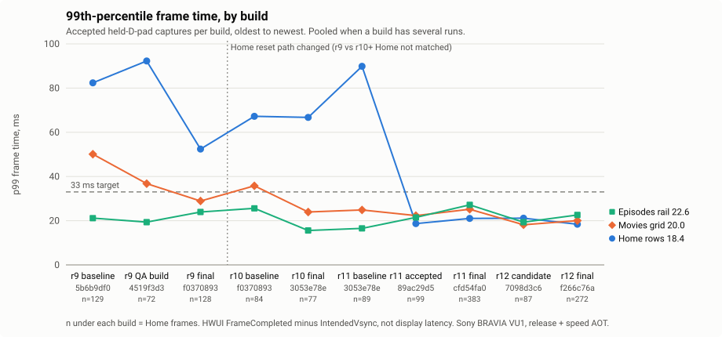
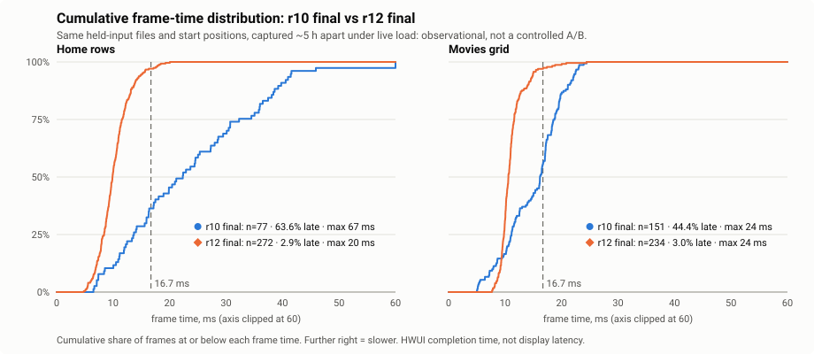
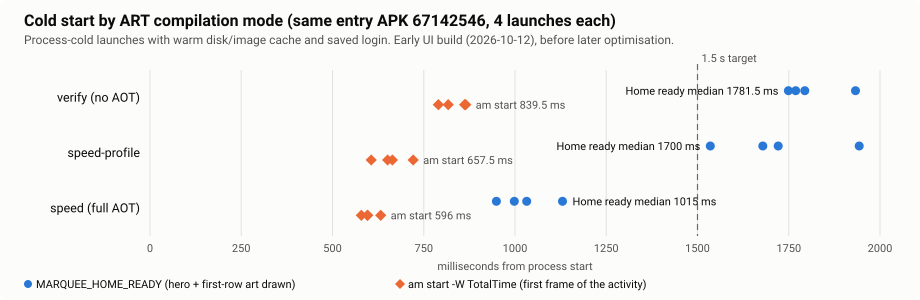

# Marquee benchmarks

This is the measurement record from Marquee's private development on one Android
TV. Every number is recomputed from raw samples that are published here in
sanitized form ([`data/`](data/)). Each table names its sample size, statistic,
date and APK. [`PROVENANCE.md`](PROVENANCE.md) traces every campaign back to the
build it measured.

> **Scope.** All measurements were taken from 2026-10-12 to 2026-10-13 on
> private development builds running on **one** Sony BRAVIA VU1. **Nothing here
> measures the code in this repository.** The public build has not been
> benchmarked. Neither has the last private release (2026-11-08, Skip Credits
> fix), nor any other device. Most cells are single short runs under live
> household load. They show what was observed and how it changed between
> optimization rounds. They are not guarantees, frame-rate claims or universal
> speedups.

**Contents:** [Reference device](#reference-device) ·
[Method](#method) · [Navigation frame times](#navigation-frame-times) ·
[Matched comparisons](#matched-comparisons) · [Startup](#startup) ·
[Playback](#playback) · [Memory](#memory) · [APK size](#apk-size) ·
[Host-side proxies](#host-side-proxies-not-tv-measurements) ·
[Renderer spike](#renderer-spike-synthetic-scene-not-marquee) ·
[Failures and limits](#failures-exclusions-and-things-never-measured) ·
[Disagreements with earlier notes](#where-recomputation-disagrees-with-earlier-notes) ·
[What this shows](#what-this-does-and-does-not-show) · [Reproduce](#reproduce)

## Reference device

| Property | Value |
|---|---|
| TV | Sony BRAVIA VU1 |
| OS | Android 11 (API 30), 32-bit `armeabi-v7a` userspace |
| SoC | Realtek RTD287O, 4× ARM Cortex-A55 |
| GPU | Mali-G31, GLES 3.2 |
| RAM | 2 GiB; Dalvik growth limit 192 MiB (512 MiB with `largeHeap`) |
| Display | one mode only: 1920×1080 at 60 Hz, density 320 (no refresh-rate switching) |
| Video decode | Realtek OMX: HEVC Main/Main10/HDR10 up to 4096×2176 L5.1; H.264 up to 1920×1088 L4.2 (8-bit only); no AV1, no Dolby Vision decoder, no TrueHD |
| HDR output | HDR10 and HLG (no Dolby Vision, no HDR10+) |
| Network | household Wi-Fi to a LAN server, with normal traffic present |
| Server | Jellyfin 10.11.11 |
| App build | release (R8, non-debuggable, `armeabi-v7a` only) with a bundled baseline profile, then **full `speed` AOT** (`cmd package compile -m speed -f`), verified before each capture. The one exception is the compiler-mode startup comparison, which deliberately also launches without full AOT (`verify`, `speed-profile`). |

## Method

**Navigation frame times.** A virtual USB keyboard (Android's `hid` tool) holds
D-pad keys along a fixed path, so the framework produces real key-repeat events.
This is synthetic input, not a physical remote. While keys are held, the harness
polls `dumpsys gfxinfo <pkg> framestats` about every 0.65 s. Polls are
concatenated and de-duplicated by `IntendedVsync`. Frames with non-zero `Flags`
or incomplete timestamps are dropped, and only frames inside the input window are
kept. The parser is [`bench/marquee_bench/framestats.py`](../../bench/marquee_bench/framestats.py).

* **Frame time** is `FrameCompleted − IntendedVsync`: when HWUI finished the
  frame. It is **not** display latency, input-to-photon latency or a count of
  missed refreshes. The input-timestamp columns were always empty on this TV, so
  key-to-frame latency could not be derived.
* **Late** means frame time > 16.7 ms (one 60 Hz period). A frame can be late by
  this definition and still be presented on time, because Android pipelines
  frames.
* **Percentiles** use the nearest rank, so every value reported is an observed
  frame. For n < 100, p99 equals the slowest frame.
* **Protocol.** The app is force-stopped and launched cold (disk image cache and
  login kept), then navigated to the surface. One unmeasured pass warms images
  and view reuse, the start position is reset, then the measured pass runs. From
  r9 to r12 the held-input file for each surface was byte-identical. r10 changed
  the Home reset to a paced Back/Down sequence and fixed the start positions, so
  **r9 Home numbers are not comparable with r10+ Home numbers.**
* The original working targets were < 5% late frames, p50 < 10 ms (QA) or
  < 11 ms (r12 notes), and p99 < 33 ms.

**Startup.** `am start -W` TotalTime marks the activity's first frame.
`MARQUEE_HOME_READY` is logged by the app once the Home hero backdrop (and logo)
and every visible first-row card have been drawn. Cold launches measure from
process start, so app data, the saved login, the disk image cache and the OS page
cache remain warm. A truly cold first-login start was never measured. Warm
launches measure from Activity start and exclude bring-to-front time.

**Playback.** These timings come from the player's own log markers. *Start* and
*resume* run from player Activity `onCreate` to the first rendered video frame
(Media3 `onRenderedFirstFrame`). *Seek* runs from seek commit to the first new
frame and excludes the 650 ms scrub debounce. Every playback number includes
server negotiation and network time. It is not a panel or acoustic measurement.

**Statistics.** Medians of small startup sets are conventional medians. Nothing
here has a confidence interval. Most cells come from one run, so sampling noise
is not quantified. Repeated runs on the same build show how large it is: four
Home runs on `cfd54fa0` ranged from 4.1% to 13.5% late frames.

## Navigation frame times

### Latest accepted build, `f266c76a` (2026-10-13 07:40–07:48)

| Surface | Runs | Frames | Late (>16.7 ms) | p50 | p90 | p95 | p99 | Max |
|---|---:|---:|---:|---:|---:|---:|---:|---:|
| Home rows | 3 (pooled) | 272 | 8 (2.94%) | 9.88 ms | 13.73 ms | 15.23 ms | 18.42 ms | 20.05 ms |
| Movies grid | 2 (pooled) | 234 | 7 (2.99%) | 10.59 ms | 14.03 ms | 14.99 ms | 20.03 ms | 24.43 ms |
| Episodes rail | 1 | 87 | 4 (4.60%) | 11.16 ms | 14.84 ms | 16.60 ms | 22.60 ms | 22.60 ms |
| Search results | 1 | 318 | 10 (3.14%) | 9.45 ms | 13.90 ms | 15.21 ms | 21.22 ms | 40.88 ms |
| Player OSD | not measured: playback failed to start on this build ([failures](#failures-exclusions-and-things-never-measured)) | | | | | | | |

Per-run Home late share: 4.12%, 2.30% and 2.27%. Movies: 3.42% and 2.56%. The
most recent complete OSD capture is on `cfd54fa0` (r11 final): 163 frames, 4.29%
late, p50 8.52 ms, p99 33.33 ms. Its p99 misses the 33 ms target.

### By build




Each cell is late % / p50 / p99 in ms, followed by the frame count. Build sets
are oldest first. "Baseline" rows re-measure the previous final APK under the
next round's protocol.

| Build set | APK | Home | Movies | Episodes | Search | OSD |
|---|---|---|---|---|---|---|
| r9 baseline | `5b6b9df0` | 62.0 / 22.2 / 82.4 (129) | 59.6 / 22.2 / 50.1 (228) | 15.1 / 11.4 / 21.2 (119) | 4.4 / 10.0 / 20.7 (318) | 3.6 / 6.8 / 22.7 (138) |
| r9 QA build | `4519f3d3` | 76.4 / 31.4 / 92.3 (72) | 63.1 / 23.0 / 36.8 (225) | 10.1 / 11.8 / 19.4 (119) | 4.7 / 9.6 / 22.2 (318) | 2.2 / 7.8 / 19.3 (139) |
| r9 final | `f0370893` | 68.0 / 22.3 / 52.4 (128) | 45.7 / 15.1 / 28.9 (210) | 17.6 / 11.4 / 23.9 (119) | 3.5 / 9.6 / 21.5 (318) | 6.6 / 8.3 / 33.3 (136) |
| r10 baseline (paced reset) | `f0370893` | 73.8 / 28.3 / 67.2 (84) | 47.1 / 15.5 / 35.8 (210) | 10.9 / 11.7 / 25.6 (119) | 3.5 / 9.5 / 24.2 (318) | 2.9 / 8.0 / 20.2 (138) |
| r10 final | `3053e78e` | 63.6 / 22.3 / 66.7 (77) | 44.4 / 16.2 / 23.9 (151) | 0.0 / 10.9 / 15.6 (87) | 3.1 / 9.5 / 21.5 (318) | 5.1 / 7.9 / 21.5 (136) |
| r11 baseline | `3053e78e` | 58.4 / 18.7 / 89.9 (89) | 44.4 / 15.8 / 24.9 (151) | 0.0 / 10.4 / 16.5 (87) | 4.1 / 9.8 / 22.4 (318) | 3.7 / 7.3 / 32.8 (136) |
| r11 accepted | `89ac29d5` | 2.0 / 9.8 / 18.7 (99) | 6.8 / 10.9 / 22.3 (117) | 4.6 / 10.8 / 21.5 (87) | 4.7 / 9.4 / 22.5 (318) | 3.8 / 7.7 / 42.3 (158) |
| r11 final | `cfd54fa0` | 8.9 / 10.0 / 21.0 (383, 4 runs) | 3.8 / 10.2 / 25.2 (235, 2 runs) | 3.4 / 11.1 / 27.2 (87) | 3.5 / 9.7 / 24.1 (318) | 4.3 / 8.5 / 33.3 (163) |
| r12 candidate | `7098d3c6` | 8.0 / 10.4 / 21.1 (87) | 3.4 / 10.6 / 18.2 (116) | 3.4 / 10.4 / 19.3 (87) | 5.0 / 9.9 / 23.7 (318) | failed to start |
| r12 final | `f266c76a` | 2.9 / 9.9 / 18.4 (272, 3 runs) | 3.0 / 10.6 / 20.0 (234, 2 runs) | 4.6 / 11.2 / 22.6 (87) | 3.1 / 9.5 / 21.2 (318) | failed to start |

The two large steps, Movies in r9 and Home in r11, line up with specific changes:
a pool of retained native rows in the Movies grid (r9), and a native Home rail
plus cached text layouts (r11). Only the Movies change has a same-APK control
(below). The other rows compare different APKs captured hours apart.

## Matched comparisons

### Same-APK A/B controls

One APK with a runtime flag switched, captured minutes apart on the same path.
These are the controlled results in this record. Each is still a short
sequential pair.


| Comparison (APK, date) | Variant A | Variant B | Reading |
|---|---|---|---|
| Movies: legacy lazy grid vs retained 5-row native grid (`eec21927`, 10-13 00:46–00:47) | 235 frames, 64.68% late, p50 23.47, p99 52.29 ms | 210 frames, 46.19% late, p50 15.41, p99 30.01 ms | Retained grid: 18.5 points fewer late frames, p99 −43%. Still far above 5%. |
| Movies: lazy prefetch off vs on (`5b6b9df0`, 10-12 23:16 / 23:23) | 222 frames, 65.77%, p99 61.84 ms | 228 frames, 59.65%, p99 50.09 ms | No evidence for disabling prefetch. Small gap. |
| Home: horizontal parent anchor off vs on (`eec21927`, 10-13 00:38–00:39) | 74 frames, 77.03%, p99 135.43 ms | 68 frames, 80.88%, p99 137.31 ms | No benefit seen. Both variants far over budget. |
| Home: software RGB565 vs hardware bitmaps (`618e6561`, 10-12 14:16, 2 runs each) | 565 frames, 18.05%, p99 43.87 ms | 596 frames, 18.96%, p99 42.79 ms | No consistent difference. Per-run late share varied 14–22%. |
| Movies: software vs hardware bitmaps (`618e6561`, 14:21–14:22) | 70 frames, 1.43%, p99 17.59 ms | 72 frames, 2.78%, p99 18.29 ms | Too few frames to separate. |
| Series detail: software vs hardware bitmaps (`618e6561`, 14:22–14:23) | 157 frames, 10.19%, p99 53.06 ms | 155 frames, 15.48%, p99 119.85 ms | Hardware was worse in this single pair. |

The r4 bitmap pairs used the early r4 protocol (12 s path) on an early UI. They
are not comparable with the r9+ numbers.

### Cross-build comparisons (observational)

These pairs use the same held-input file and start position. The APKs, times and
live server content all differ, so they are **not** controlled A/B tests.



| Pair (gap) | Surface | Before: late % / p50 / p99 (n) | After: late % / p50 / p99 (n) |
|---|---|---|---|
| r10 baseline `f0370893` → r10 final `3053e78e` (~1 h) | Home | 73.8 / 28.3 / 67.2 (84) | 63.6 / 22.3 / 66.7 (77) |
| | Movies | 47.1 / 15.5 / 35.8 (210) | 44.4 / 16.2 / 23.9 (151) |
| | Episodes | 10.9 / 11.7 / 25.6 (119) | 0.0 / 10.9 / 15.6 (87) |
| | OSD | 2.9 / 8.0 / 20.2 (138) | 5.1 / 7.9 / 21.5 (136) |
| r11 baseline `3053e78e` → r11 accepted `89ac29d5` (~2.5 h) | Home | 58.4 / 18.7 / 89.9 (89) | 2.0 / 9.8 / 18.7 (99) |
| | Movies | 44.4 / 15.8 / 24.9 (151) | 6.8 / 10.9 / 22.3 (117) |
| | OSD | 3.7 / 7.3 / 32.8 (136) | 3.8 / 7.7 / 42.3 (158) |
| r11 final `cfd54fa0` → r12 final `f266c76a` (~1.8 h) | Home | 8.9 / 10.0 / 21.0 (383) | 2.9 / 9.9 / 18.4 (272) |
| | Movies | 3.8 / 10.2 / 25.2 (235) | 3.0 / 10.6 / 20.0 (234) |
| | Episodes | 3.4 / 11.1 / 27.2 (87) | 4.6 / 11.2 / 22.6 (87) |
| r10 final `3053e78e` → r12 final `f266c76a` (~5.3 h, plotted above) | Home | 63.6 / 22.3 / 66.7 (77) | 2.9 / 9.9 / 18.4 (272) |
| | Movies | 44.4 / 16.2 / 23.9 (151) | 3.0 / 10.6 / 20.0 (234) |

The same APK measured twice can differ substantially. `f0370893` gave 68.0%
late frames on Home under the r9 reset and 73.8% under the paced r10 reset. Its
Episodes result moved from 17.6% to 10.9% between r9 final and r10 baseline.
Treat differences of a few points between single runs as noise. Home run-to-run
variation on `cfd54fa0` spanned 9.4 points.

## Startup

### Compilation mode (entry UI build `67142546`, 2026-10-12 13:11–13:13)



| Compile state | n | `am start -W` TotalTime median (range) | HOME_READY median (range) |
|---|---:|---:|---:|
| `verify` (no AOT) | 4 | 839.5 ms (790–865) | 1781.5 ms (1749–1933) |
| `speed-profile` | 4 | 657.5 ms (606–721) | 1700 ms (1535–1943) |
| `speed` (full AOT) | 4 | 596 ms (579–632) | 1015 ms (949–1130) |

On this early build, full AOT cut the median HOME_READY by 43% against `verify`
and 40% against `speed-profile`. This is why the reference protocol always
compiles with `speed`. Profile-guided compilation alone did not reach 1.5 s.
`verify` was the only no-AOT control available: this Android 11 shell cannot
reset ART profiles, so this does not represent a fresh install without profile
data. Later builds were never measured in `verify` or `speed-profile` state.

### Cold and warm start by build

| Campaign | APK | Protocol | n | `am start -W` median (range) | HOME_READY median (range) |
|---|---|---|---:|---:|---:|
| r4 final (14:03 and 14:10) | unattributed | dedicated cold | 8 | 563 ms (532–691) | 704.5 ms (656–819) |
| r9 baseline QA | `5b6b9df0` | dedicated cold | 3 | 613 ms (611–659) | 733 ms (724–780) |
| r9 baseline QA | `5b6b9df0` | dedicated warm | 3 | 101 ms (100–181), HOT | 27 ms (17–30) |
| r9 QA build | `4519f3d3` | dedicated cold | 3 | 613 ms (576–678) | 752 ms (691–816) |
| r9 QA build | `4519f3d3` | dedicated warm | 3 | 110 ms (103–112), HOT | 22 ms (17–48) |
| r12 final, harness launches | `f266c76a` | harness cold | 8 / 6 | 718 ms (693–966) | 846 ms (779–1624) |

"Harness cold" counts the launches that began each frame capture. They used the
same force-stop and `am start -W` sequence with benchmark extras. Navigation
keys were sent about 1.5 s after `am start` returned, so a HOME_READY above
about 1.5 s can include input contention (the 1624 ms Search launch). Two of the
eight launches logged no HOME_READY line in the saved excerpt. The first launch
after installing `7098d3c6` took 1219 ms to its first activity frame (single
sample). Startup stage markers for the `f266c76a` launches (ms since process
start, median of 6): `snapshot-read` 541, `disk-art-ready` 705.5. Per-launch values are
in [`data/startup_samples.csv`](data/startup_samples.csv).

### largeHeap A/B (2026-10-12 13:40 and 13:42, one launch each)

| Variant | APK | `am start` | HOME_READY | Total PSS after short browse | Java heap PSS | Native heap PSS |
|---|---|---:|---:|---:|---:|---:|
| `largeHeap=true` | unattributed (installed release) | 696 ms | 758 ms | 77,173 KiB | 18,372 KiB | 26,928 KiB |
| `largeHeap=false` | `4a1574dd` (same DEX, manifest flag only) | 770 ms | 900 ms | 92,064 KiB | 18,516 KiB | 43,276 KiB |

The PSS gap comes from native-cache residency during the two browse sessions,
not from the heap flag: Java heap PSS is essentially equal. With one launch per
side, this shows no managed-memory benefit from `largeHeap`, and no cost from
dropping it. The source default later became `largeHeap=false`.

## Playback

![Dot chart of single playback samples, grouped by build. On the QA r9 build, direct-play starts take 601–1844 ms, the 4K Dolby Vision title with server audio conversion starts in 1987 ms, and an in-place seek takes 458 ms. On the r10 player final build, the 4K title starts in 2039 ms, resumes in 2565 ms and seeks in 2568 ms, and an SDR HEVC resume takes 1447 ms. On the r12 final player, resumes take 796–1014 ms and seeks 505–1936 ms, but keyframe snapping lands resumes up to 3.7 s from the requested position.](charts/playback-first-frame.svg)

Media are aliased. The descriptors in [`data/media_aliases.csv`](data/media_aliases.csv)
give container, codec, resolution, HDR format, audio, and how the server
delivered each stream. "Video copy + audio conversion" means the server remuxed
the original HEVC video unchanged and converted only the audio. The TV has no
TrueHD decoder.

| Build (date) | Media | Delivery | Event | Time to first frame | Landing vs target |
|---|---|---|---|---:|---:|
| `4519f3d3` QA (10-12 23:42–10-13 00:05) | media-D: 1920×800 H.264 SDR, AC3/E-AC3 5.1 | direct play | start | 601 ms | n/a |
| | media-E: 1920×800 HEVC Main10 SDR, E-AC3 5.1 | direct play | start | 649 ms | n/a |
| | media-B: 3164×2152 HEVC Main10 DV + HDR10+, E-AC3 5.1 | direct play | start (2) / seek | 608, 1097 ms / 458 ms | not logged |
| | media-G: 1920×1080 H.264 SDR episode, E-AC3 2.0 | direct play | start (2) | 1004, 1178 ms | n/a |
| | media-F: 1920×804 HEVC Main10 SDR episode, AAC 5.1 | direct play | start | 1844 ms | n/a |
| | media-A: 3840×2160 HEVC Main10 DV (HDR10 base), TrueHD 7.1 | video copy + audio conversion | start / resume | 1987 ms / 735 ms | not logged |
| | media-A | video copy + audio conversion | seek (stream re-open) | **9503 ms** prepare→frame (19.4 s cumulative) | not logged |
| `f0370893` r10 player final (10-13 01:01–01:14) | media-A | video copy + audio conversion | start / resume / seek | 2039 / 2565 / 2568 ms | stream restarted 3.46 s before the resume target (landing not logged) |
| | media-H: 3840×1608 HEVC HDR10, TrueHD 7.1, PGS | video copy + audio conversion | resume (3 cases) / PGS track restarts (4) | 2419–2516 ms / 1878–4088 ms | n/a |
| | media-I: 3840×1604 HEVC DV + HDR10, DTS-HD MA, PGS | video copy + audio conversion | resume / restarts | 2183 ms / 2051–2764 ms | n/a |
| | media-C: 1920×804 HEVC Main10 SDR, AAC, SRT | direct play | resume | 1447 ms | n/a |
| `55cc9857` r11 (10-13 01:51–01:58) | media-A | video copy + audio conversion | resume / seek 1 / seek 2 | 6742 / 6090 / 3109 ms | +6 / +10 / +24 ms (exact) |
| | media-B | direct play | resume / seek | 7891 / 7654 ms | +6 / +33 ms (exact) |
| | media-C | direct play | resume | 1337 ms | +6 ms (exact) |
| `d2d2e752` r12 final player (10-13 02:48–02:51) | media-A | video copy + audio conversion | resume / seek 1 / seek 2 | 1014 / 1936 / 1898 ms | −3706 / +3 / +3705 ms (keyframe) |
| | media-B | direct play | resume / seek | 796 / 505 ms | −3372 / −274 ms (keyframe) |
| | media-C | direct play | resume | 911 ms | −2538 ms (keyframe) |
| `a1e3841b` r14, partial (10-13 08:53–09:00) | media-B | direct play | start / seek | 1428 / 180 ms | 0 / +1629 ms |
| | media-A (after TV reboot/wake) | video copy + audio conversion | start | 2866 ms | 0 |

r11 and r12 show a trade-off between speed and accuracy, not a straightforward
speedup. r11 decoded through to the exact requested frame, landing within 33 ms
but taking 3–8 s. r12 snaps to a nearby keyframe: 0.5–1.9 s, but resumes land
2.5–3.7 s before the saved position, and one seek landed 3.7 s after its target.
The 1014 ms media-A resume also benefits from a stream prewarmed on the detail
screen. An earlier intermediate run that discarded the prewarmed stream resumed
in 3425 ms. Each row is a single sample. Seek targets differ between rounds.

## Memory

PSS from `dumpsys meminfo` at the end of each `f266c76a` capture: single
snapshots after a short browse, not peaks.

| Snapshot (after) | Total PSS | Java heap | Native heap | Code |
|---|---:|---:|---:|---:|
| Home, run 1 / 2 / 3 | 100,539 / 84,431 / 96,345 KiB | 26,064 / 15,316 / 25,156 KiB | 43,444 / 38,632 / 40,828 KiB | ~18.3 MiB |
| Movies, run 1 / 2 | 111,993 / 99,667 KiB | 22,464 / 11,872 KiB | 58,552 / 57,252 KiB | ~17.8 MiB |
| Search | 96,004 KiB | 30,636 KiB | 34,536 KiB | 18,292 KiB |
| Episodes | 81,958 KiB | 16,968 KiB | 33,612 KiB | 18,640 KiB |

During playback, the last OSD captures (`cfd54fa0`, `89ac29d5`) ended at
163,679 and 170,296 KiB total PSS. An early (r4, unattributed) 4K media-A sample
reached 177,159 KiB 25 s into playback, with Java heap PSS of 105,424 KiB, which
includes decoder and software-audio buffers. This vendor build reports
`Graphics` as 0, so GPU memory is not visible in these figures. No long-duration
playback, peak or low-memory-killer study exists beyond a 25-second sample.

## APK size

| Build type | Size | Notes |
|---|---:|---|
| release, r9 (`5b6b9df0`, `4519f3d3`) | 3,755,006 bytes | R8 + resource shrinking, `armeabi-v7a` only, bundled baseline profile |
| release, r10 final (`3053e78e`) | 3,771,390 bytes | |
| release, r12 final (`f266c76a`), r13 (`868ef47b`), r14 (`a1e3841b`) | 3,804,158 bytes | |
| profile (release-inherited, Compose tracing) | 6,369,780–6,402,548 bytes | measurement-only variant |
| debug | 20,655,925 bytes | not used for any timing |

Sizes cover the whole APK, including the media3 FFmpeg audio decoder for
`armeabi-v7a`. All 69 artifact files are listed in
[`data/apk_artifacts.csv`](data/apk_artifacts.csv).

## Host-side proxies (not TV measurements)

**Navigation key-handler time (JVM, Robolectric SDK 30, offline fixtures,
2026-10-13).** This is host CPU time spent inside the app's D-pad handlers and
focus callbacks for each key event. It shows how much work moved out of the key
path. It does not represent Cortex-A55 timing or frame time.

| Screen | Events | Before: median / max | After: median / max |
|---|---:|---:|---:|
| Home (wall time) | 10 | 4.12 / 22.24 ms | 1.20 / 1.59 ms |
| Library | 10 | 1.08 / 1.44 ms | 0.91 / 1.16 ms |
| Series | 13 | 1.37 / 4.59 ms | 1.18 / 1.67 ms |
| Player OSD | 15 | 0.80 / 26.23 ms | 0.52 / 2.88 ms |

**Server remux time to first decodable frame (2026-10-12, before the r10–r12
player changes).** Jellyfin was asked for media-A with copied 4K HEVC video and
converted audio. The host fetched the stream and decoded the first frame with
`ffprobe`. These are server and network timings, not TV TTFF.

| Variant (original label) | Start position | n | Median (range) |
|---|---|---:|---:|
| progressive MKV (`progressive-mkv`) | 0 s | 3 | 5.40 s (5.19–5.89) |
| progressive MPEG-TS (`progressive-ts`) | 0 s | 3 | 5.66 s (5.55–5.75) |
| HLS, 3 s fMP4 segments (`hls-3-1`) | 0 s | 3 | 6.36 s (6.33–6.84) |
| HLS, 4 s fMP4 segments (`hls-4-1`) | 0 s | 3 | 6.43 s (6.36–6.45) |
| HLS, 2 s segments (`hls-2-1` / `hls-2-0`) | 0 s | 3 each | 6.55 s / 6.73 s |
| HLS, 4 s segments, timed start | 25 s / 600 s | 1 each | 8.80 s / 13.27 s |

Only the serialized version-2 samples are shown, matching the original
analysis. The exploratory version-1 runs are kept in
[`data/host_proxies.json`](data/host_proxies.json) with `final=false`. These
measurements prompted the progressive-container restart path that later rounds
adopted. They describe the server's behaviour on that day only.

## Renderer spike (synthetic scene, not Marquee)

Before the app was built, the same focus-grid scene was implemented in Compose,
Views and GLES3. Each was built as a release with R8 and full AOT and run on the
same TV. Full numbers are in [`data/renderer_spike.json`](data/renderer_spike.json).

| Approach | Runs / frames | Missed focus refreshes (SurfaceFlinger) | HWUI or GPU-ready p50 / p99 | App CPU (one core = 100%) | PSS median |
|---|---:|---:|---:|---:|---:|
| Compose, optimized | 3 / 2488 | 3.22% | 8.58 / 26.50 ms (HWUI) | 31.5% | 80.9 MiB |
| Views, no temporary layers | 2 / 2210 | 2.11% | 7.51 / 24.55 ms (HWUI) | 30.4% | 57.3 MiB |
| GLES3 | 3 / 3566 | 0.53% | 13.79 / 26.21 ms (vsync to GPU-ready) | 16.4% | 53.1 MiB |

Compose was kept for the app. These figures cannot stand in for Marquee
measurements, and the timing endpoints differ by renderer.

## Failures, exclusions and things never measured

**Excluded or failed captures.** All are retained in the data with their status.

* r12 OSD (`7098d3c6`, `f266c76a`): three attempts. Playback reported a decoder
  failure before the first frame, so OSD frame times do not exist for the final
  UI builds. r13 reproduced this on every fallback (direct play, remux, HEVC,
  H.264): the hardware decoder could not acquire resources (`ret=12`). The owner
  rebooted the TV at 08:44. No r13 build ever reached a first frame, so r13 has
  no playback timing.
* r14 (`a1e3841b`): cancelled by the owner at 09:03. Two valid single samples
  remain. One case labelled as a media-A start actually played media-B (log
  evidence). Its 623 ms is excluded as **misrouted**. Six attempts failed before
  playback.
* r11 Home captures on `cee0b85b`, `c4aff44c` and `a456661b` looked fast
  (1.6–4.8% late), but the native card artwork was not drawn on the TV.
  They are marked **invalid**.
* r9 Movies "fast reset" A/B pair (re-entered stale coordinates), two timed-out
  paced pairs, the r9 exploratory Home path, rushed or timed-out r10 Home
  captures, one misrouted r4 Search capture and one r4 Home run that crashed.
* Tracing sessions (atrace or Perfetto on profile builds) appear with status
  `diagnostic`. Tracing overhead makes them incomparable with normal runs.

**Surfaces and cases that stayed over target.**

* Episodes on `f266c76a`: p50 11.16 ms misses both the 10 ms and the 11 ms p50
  targets.
* Player OSD p99: 33.33 ms on `cfd54fa0` and 42.32 ms on `89ac29d5`, against
  the 33 ms target.
* Search's slowest frame on `f266c76a` took 40.9 ms.
* Seeks that re-open a video-copy stream: 8.7–9.5 s prepare→frame on r9 and
  2.6 s on r10. r12 traded accuracy for 1.9 s.
* PGS subtitle track changes forced a stream restart of up to 4.1 s (r10).
* Exact-position seeking (r11) took 3–11 s.

**Never measured.**

* **This repository's build.** No measurement touches the public fork.
* **The 2026-11-08 Skip Credits release** (`214e95eb…`). It was installed on the
  TV, but no benchmark was run, and Skip Credits was not exercised during a real
  credits sequence.
* Any other device: other TVs, streaming sticks, arm64 userspace (the APK ships
  `armeabi-v7a` only), other GPUs or Android versions.
* First-install state (baseline profile only, before `speed` compilation) for any
  build after the entry build. A truly cold start: first login, empty image
  cache, network refresh.
* Physical latency: key-to-photon, key-to-frame, or a missed-refresh count for
  the app. The input timestamp columns were empty, and only the synthetic spike
  has presentation data.
* Playback of server **video** transcodes (HEVC or H.264 encode): every attempt
  failed on the TV. Also never measured: AV1 and H.264 High10 sources, 30 fps
  sources at 2× speed, acoustic audio output, the HDR panel itself, long playback
  sessions, memory peaks, low-memory-killer behaviour, and thermal throttling.
* Statistical confidence. Almost every cell is one run. There are no repeated
  sessions across days, and the network and server were not isolated.

## Where recomputation disagrees with earlier notes

All numbers above were recomputed from per-frame samples with the nearest-rank
definition. Earlier private notes mostly agree to the reported precision. The
exceptions:

| Earlier note | Earlier value | Recomputed / correct value | Why |
|---|---|---|---|
| QA report, r9 hdrfix Home "baseline" | 64.58% late, p99 70.25 ms | 62.02%, p99 82.37 ms (`r9-baseline-home-exact`) | The QA report quoted the exploratory Home run, which used a different held-input file and which the performance notes had excluded |
| r4 render summary, episode detail p50 | 8.161 ms | 8.150 ms | The early helper used a different percentile method; other r4 values match |
| r9 player notes, media-A resume | 2.083 s | 2.083 s and 2.152 s | Two complete resume samples exist on `4519f3d3`; the notes cited one |
| r12 summary table, latest OSD | `3053e78e`: 5.15% / p99 21.51 ms | Later complete OSD captures: `89ac29d5` 3.80% / 42.32 ms, `cfd54fa0` 4.29% / 33.33 ms | The table omitted the r11 OSD captures, which are less favourable |
| r14 case result labelled as a media-A start | 623 ms | excluded (misrouted) | The player log shows media-B was prepared and played |
| QA report, media-D described as "1080p AC3" | n/a | 1920×800 H.264 with AC3 and E-AC3 tracks | Descriptor only, no timing impact |
| Targets: p50 < 10 ms (QA) vs < 11 ms (r12 notes) | n/a | both shown | Episodes on `f266c76a` (11.16 ms) misses both |

The QA report ([private] `docs/QA_REPORT.md`, r9 build `4519f3d3`) is
**historical**. Its startup and playback numbers are correct for that build, but
later rounds (r10–r14) superseded its navigation and playback results.

## What this does and does not show

**It shows that:**

* On the reference TV, full `speed` AOT mattered more than any other startup
  factor tested: about 1.0 s against 1.7–1.8 s to a drawn Home on the entry
  build.
* Process-cold launches with warm caches reached a drawn Home in roughly
  0.7–0.85 s on the r9-era builds (3 + 3 dedicated samples) and the r12 final
  build (6 harness samples).
* Held-D-pad navigation on the final accepted UI build (`f266c76a`) had about
  3–5% of frames over 16.7 ms on Home, Movies, Episodes and Search, with p99
  between 18 and 23 ms, under a fixed synthetic input path.
* The retained native Movies grid reduced late frames in a same-APK control. The
  large Home improvement in r11 coincided with the native rail work, but has no
  same-APK control.
* Direct-play starts took 0.6–1.8 s. 4K video-copy starts took about 2 s.
  Keyframe-snapped resumes and seeks took 0.5–1.9 s, at the cost of landing up to
  3.7 s away from the requested position.

**It does not show:**

* How this repository's build performs, or how any build performs on other
  hardware.
* Sustained 60 fps, display-level smoothness, or input latency.
* That any change caused a speedup, except the same-APK controls, and even those
  are single short pairs.
* Run-to-run variance or confidence intervals. The single-run cells could move
  by several points on a re-run.
* Behaviour on a cold network, with server video transcoding, during long
  sessions, or under memory pressure.

## Reproduce

```bash
# from the repository root; stdlib only, no device needed
uv run --no-project python bench/summarize.py        # recompute data/summary.json from the CSVs
uv run --no-project python bench/make_charts.py      # redraw charts/*.svg from data/
uv run --no-project python bench/validate_data.py    # schema + privacy + freshness checks
uv run --no-project --with pytest pytest bench/      # offline unit tests
```

To measure your own TV and server, see [`bench/README.md`](../../bench/README.md).
The capture tools there were ported from the harness that produced this record.
Their device paths have not been re-run since porting.

**Build type for new measurements.** Public `release` builds now strip info-level logging with R8
(`app/proguard-release-logs.pro`) and are not shell-profileable, so the startup and player markers
used for the startup and playback sections exist only in `debug` and `profile` builds. Reproduce with
the `profile` build (`./gradlew :app:assembleProfile`: R8, non-debuggable, shell-profileable, signed
with the build machine's debug key). The numbers on this page were measured on private *release*
builds that still logged these markers (`armeabi-v7a` only, no tracing libraries). A profile build
adds Compose runtime tracing, the Perfetto library and 64-bit libraries, so its numbers are not
strictly like-for-like with this record. Frame-time captures read `dumpsys gfxinfo` and need no
markers, so they can also be repeated on a release build.
