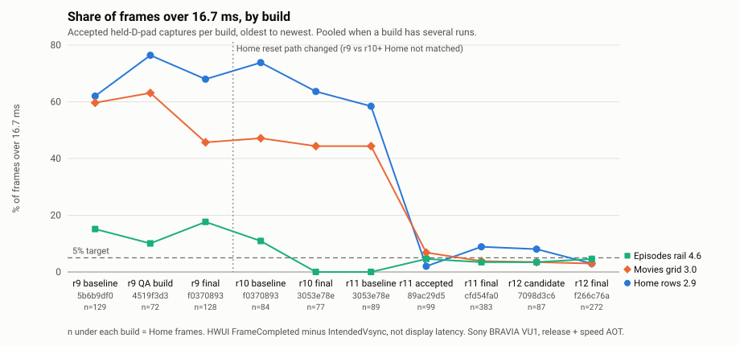
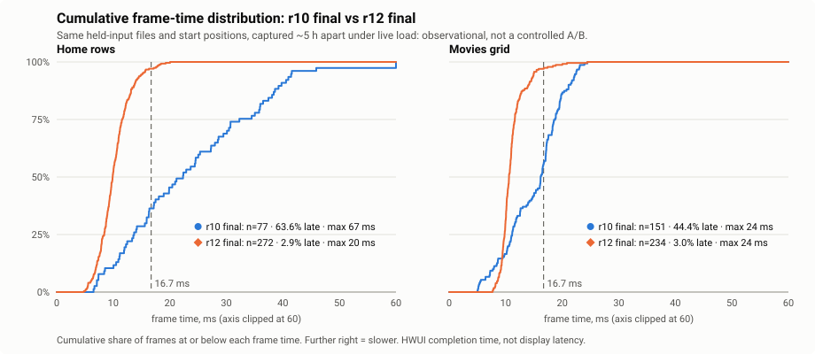

## Performance (measured during development)

All numbers below are from private development builds on **one Sony BRAVIA VU1**
(Android 11, Realtek RTD287O / 4× Cortex-A55, Mali-G31, 2 GiB, 1080p60), on
2026-10-12 and 10-13, talking to Jellyfin 10.11.11 over household Wi-Fi. All
headline figures are from release (R8) builds compiled with full `speed` AOT,
except the "Full AOT vs no AOT" row, which compares full AOT against launches
without it (`verify` and `speed-profile`). **The code in this
repository has not been benchmarked yet.** Most figures are single short runs.
Details, raw data and caveats: [docs/benchmarks](README.md).

| What | Result | n, build |
|---|---|---|
| Held-D-pad navigation, final accepted UI build: share of frames over 16.7 ms | Home 2.9%, Movies 3.0%, Episodes 4.6%, Search 3.1% | 272 / 234 / 87 / 318 frames, `f266c76a` |
| Same, p50 / p99 frame time | Home 9.9 / 18.4 ms, Movies 10.6 / 20.0 ms, Episodes 11.2 / 22.6 ms | as above |
| Home before the r11 native-rail work (same protocol, earlier APK; not a controlled A/B) | 58–64% of frames over 16.7 ms, p99 67–90 ms | 77–89 frames, `3053e78e` |
| Movies grid, same-APK control: legacy lazy grid → retained native rows | 64.7% → 46.2% of frames late, p99 52 → 30 ms | 235 / 210 frames, `eec21927` |
| Cold start to a drawn Home (warm disk cache, saved login) | median 752 ms (691–816) | 3 launches, `4519f3d3` |
| Warm return to Home (excludes bring-to-front) | median 22 ms (17–48) | 3 launches, `4519f3d3` |
| Full AOT vs no AOT, entry build: cold start to Home | 1015 ms vs 1782 ms median | 4 + 4 launches, `67142546` |
| Playback start, direct play (1080p-class SDR to 3164×2152 HDR) | 0.6–1.8 s to first frame (601–1844 ms) | 7 starts, 5 titles (1–2 each), `4519f3d3` |
| Resume / seek, final player build | 0.8–1.0 s resume, 0.5–1.9 s seek; resumes land 2.5–3.7 s before the saved position (keyframe-snapped) | 1 each, `d2d2e752` |
| Release APK size | 3.80 MB (`armeabi-v7a` only) | `f266c76a` |

Frame time here is HWUI's `FrameCompleted − IntendedVsync` under synthetic USB
key-repeat input. It is not display latency or input latency, so this record
makes no claim of a sustained 60 fps. The player controls overlay could not be
measured on the final UI build because playback failed to start (the TV's
hardware decoder could not acquire resources; playback worked again after a
TV reboot). Server video transcodes never
reached a first frame on the TV. No other hardware was tested.

